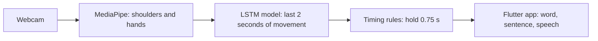

# Sign Language Translator

مترجم يقرأ إشارات لغة الإشارة السعودية من كاميرا الحاسب، ويعرضها نصاً بالعربية أو الإنجليزية داخل تطبيق Flutter.

Reads Saudi Sign Language signs (one or two hands) from a webcam and shows them as Arabic or English text in a chat-style app built with Flutter. It recognises 37 words from the official dictionary of the Saudi Association for Hearing Impairment (<https://sshi.sa>).



**Status:** training (Phase 1), live translation (Phase 2) and the chat app (Phase 3) work.

- **The original 8 words:** dictionary clips plus 20 webcam recordings of each sign.
  - **Unseen recordings:** the current model recognises 94% (75 of 80).
  - **Live try:** all 8 signs were shown, and the signer confirmed each shown word by eye. That was on the earlier 8-word model.
- **The 20 newer words:** chosen so that no two signs move alike. They're trained on dictionary videos only. [new_words.md](new_words.md) lists them, with how to make each sign.
  - **Dictionary videos:** all 29 sign videos are recognised, with no wrong words, including on 23 other signs.
  - **Live use:** not properly tested yet. In the one short session so far, 3 of the 20 appeared (fine, hungry, sleep), and whether they were right wasn't recorded.
- **No overall accuracy score yet:** the app's accuracy test hasn't been run with a camera.
- **Still weak:**
  - **The free hand:** its position still matters a little. With it removed from the test samples, "hello" and "water" dropped to 60%.
  - **Ordinary movements:** before the timing rule filters them, the model reads 2 in 5 ordinary movements as a sign. It was 1 in 5 with 8 words.
  - **One signer:** the webcam recordings come from one person, so other signers may get lower results.

## Setup

You need Windows with a webcam, Python 3.12 and, for the app's screen, [Flutter](https://docs.flutter.dev/get-started/install). It was tested on Windows 11. The Python environment goes outside the project folder, because cloud-sync folders like OneDrive would try to sync thousands of package files, and MediaPipe has trouble with non-English paths.

```powershell
git clone https://github.com/ziyad4454/sign-language-translator.git
cd sign-language-translator
py -3.12 -m venv $env:USERPROFILE\.venvs\sign-translator
$py = "$env:USERPROFILE\.venvs\sign-translator\Scripts\python.exe"
& $py -m pip install -r requirements.txt
```

In every new PowerShell window, open the project folder and set `$py` again:

```powershell
$py = "$env:USERPROFILE\.venvs\sign-translator\Scripts\python.exe"
```

The trained model and MediaPipe's two tracking models are already in `model/`, so the app can run without training. To run it, follow [Deployment](#deployment).

## How to perform each sign

[signs_guide.md](signs_guide.md) (in Arabic) describes every sign step by step, with a link to its video in the official Saudi Sign Language dictionary of the Saudi Association for Hearing Impairment. You need it to test the translator live, and to record your own samples.

## Training data from the official dictionary

Instead of recording the signs yourself, build the training data from the dictionary's videos:

```powershell
& $py import_dictionary.py
```

- **What it does:** downloads the videos listed in `dictionary_signs.json` (a few hundred KB each) into `%USERPROFILE%\.sign-translator\dictionary_videos`. It tracks the signer's body and hands the same way webcam recording does, then writes 120 two-second clips per gesture to `data/dictionary/<gesture>.csv`. A video signed with the left hand is mirrored, so all the data uses the right hand.
- **Why the clips vary:** the dictionary has only one or two videos per sign. Each clip is one of those performances changed on purpose. The changes are overall speed, pace within the sign, timing in the window, position, size, tilt, hand size, the hands' path, depth and tracking noise.
- **What the variation gained:** in a test that left whole videos out of training, the unseen "please" and "help" videos were recognised in every test clip, and 87% of unseen other signs stayed "nothing". With the smaller variation used before, those figures were 90% and 83%. The test clips were the unseen videos shifted in time.
- **The `nothing` gesture:** built from other dictionary signs plus clips with no hands in view, so the model learns not to translate them. Signs that look too much like one of ours are left out, for example يحب, a hand on the chest like آسف.
- **Adding a gesture:** add its dictionary word id to `dictionary_signs.json`, run the import again, and retrain. The id is the last number in the sign's page address, e.g. `https://sshi.sa/category/14/4857`.
- **Limits:** every clip of a sign comes from the same one or two performances, which isn't the same as many people signing. Test the trained model live on the webcam. If a sign is often missed, record some samples of it yourself (next section); they're used together with the dictionary clips.
- **Where each row comes from:** `data/dictionary/sources.json` lists the dictionary video behind every row, so training can keep clips from the same video out of the test set.

Cite the dictionary (<https://sshi.sa>) as the data source in the project report.

## Recording your own samples

Optional when you use the dictionary data. Your own samples help the model recognise your signing.

```powershell
& $py collect_data.py hello --dynamic   # a sign with movement: two-second clips
& $py collect_data.py --list            # what's recorded so far, including the dictionary clips
```

All 37 signs in this project involve movement, so record every one of them with `--dynamic`. Static mode (without `--dynamic`) saves single frames and suits signs held completely still, such as alphabet letters. The script won't let one gesture's file hold both kinds.

Sit so your head, shoulders and stomach are in view. Every sample is measured relative to your shoulders, and the "help" sign is made in front of the stomach.

A window opens on top of other apps, showing the camera with your shoulder line and hand skeletons drawn on. Click it once so it receives your key presses, then press **SPACE** to start or pause, and **Q** to quit. Each sample is saved the moment it's taken, so quitting early loses nothing.

- **Dynamic:** each sample is a two-second clip. During **GET READY** (1.5 seconds), rest your hands. When the border turns red, do the sign once at a normal pace, then lower your hands. The red border stays for 3 seconds, so a sign started a little late still fits: the two seconds around your movement are kept as the sample. This repeats until the run is done. A sample is thrown away and retried if your body leaves the view during those two seconds, or if no hand was visible for most of them (except for `nothing`).
- **Static:** hold the sign. About 6 samples are saved per second. While you hold it, slowly change your angle, distance and position.

Record each gesture in two runs of 20 (`--samples 20`) instead of one run of 40. Between runs, change the lighting, where you sit, or which way you face. If every sample is taken in one position, the model only works in that position.

### Gesture list

| Name to type | Sign (official dictionary entry) | Hands |
|---|---|---|
| `hello` | السلام عليكم | right |
| `thank_you` | شكراً | right |
| `yes` | نعم | right |
| `no` | لا | right |
| `please` | لو سمحت | right |
| `help` | مساعدة | both |
| `water` | ماء | right |
| `sorry` | آسف | right |
| `nothing` | Never shown in the chat. Record with `--dynamic`: hands resting, or moving without signing. | – |

The other 20 words and their names are in [new_words.md](new_words.md).

"Right" means your main hand. Left-handed signers can use their left hand for every sign, as long as it's the same hand in every recording.

Aim for 40 samples of every gesture. Keep the counts roughly equal: a gesture with many more samples than the rest pulls the model's guesses toward it.

## Training (Phase 1)

The dictionary clips aren't in this repository, so build them first. It downloads the videos, then training takes about 10 minutes on a CPU:

```powershell
& $py import_dictionary.py
& $py train_model.py
```

- **What it trains:** a random forest for static gestures and a small LSTM network for dynamic gestures, using every CSV under `data/`. All 37 signs in this project are dynamic.
- **What it prints:**
  - how many samples each gesture has, with a warning if any gesture has fewer than 30 or the counts are uneven;
  - accuracy and a confusion matrix on a random 20% test split;
  - "unseen video" checks, which leave whole dictionary videos out of training.
- **Reading the numbers:** dictionary clips made from the same video resemble each other, so the random split's accuracy is optimistic. The unseen-video checks are closer to a new person signing. The real test is the live webcam.
- **What it saves:**
  - `model/gesture_lstm.keras`: the dynamic model;
  - `model/gesture_static.pkl`: the static model, when there are static samples;
  - `model/labels.json`: gesture names in the models' order, plus the clip size the models expect.

Run it again after importing or recording more data.

## Live translation (Phase 2)

```powershell
& $py predict_live.py
```

- **What you see:** the camera with your shoulder line and hand skeletons drawn on, the three most likely gestures with their confidence, and the translated words along the bottom. Each recognised word is also printed in the terminal in English and Arabic.
- **When a word appears:** every few frames, the last two seconds of movement go to the model. A word appears only after the same gesture has stayed the top prediction, with at least 70% confidence, for 0.75 seconds.
- **Avoiding repeats:** after a word appears, it can't appear again until "nothing" has been predicted for about a second or you lower your hands. It also never appears twice within 4 seconds.
- **How the rules were chosen:**
  - Replaying the first live test, a longer run of predictions plus the repeat rules cut repeats of the same word within a few seconds from 7 to between 2 and 4.
  - After retraining with your own "nothing" clips, requiring ten predictions in a row missed the dictionary's "no" video. Eight in a row recognised all 9 dictionary sign videos.
  - Counting predictions made the rule slower on a slower computer. With the chat app open, the webcam ran at 22 frames per second, so eight in a row took over a second and short signs were never shown. The rule is now measured in seconds instead. On the dictionary videos, 0.75 seconds found all 9 signs with one wrong word, the same as eight in a row; 0.65 seconds added a second wrong word, and 0.85 seconds missed a sign.
- **Keys:** Q or ESC quits, C clears the words.
- **Testing without a camera:** `& $py predict_live.py --video clip1.mp4 clip2.mp4 --headless` runs the same steps on video files and prints the words found in each.
- **Translations:** `labels_translation.json` holds the English and Arabic text for each gesture. A gesture missing from it shows its name, and `nothing` is never shown.
- **Sign with your right hand:** to the model, a sign made with the left hand looks like a different gesture.
- **Signs that look alike:** a sign close to one of ours can still come out as that word. In testing, يأكل (eat, hand at the mouth) came out as "water", and يحب (love, hand on the chest) as "sorry".

## Chat app (Phase 3)

The app's screen is a Flutter app in `flutter_app/`. Build it once, and again after changing anything in that folder:

```powershell
cd flutter_app
flutter build web --no-tree-shake-icons
cd ..
```

The `--no-tree-shake-icons` flag is needed because this folder's path has Arabic letters. [flutter_app/README.md](flutter_app/README.md) explains why.

Then start the translator:

```powershell
& $py app.py
```

- **What happens:** the browser opens <http://127.0.0.1:8000>. The webcam, tracking and model run in `app.py`, with the same rules as `predict_live.py`, and the Flutter app shows the result.
- **What you see:**
  - the camera, with your shoulder line and hand skeletons drawn on;
  - on the camera picture: a status (hand in view, no hands, or head and shoulders not in view), a hint when you should move (closer, back, or into the middle), and the model's current guess;
  - the sentence: every word since the last new sentence, in large type under the camera;
  - the history: every word shown, with the time and its confidence.
- **Top bar:**
  - **camera icon:** turns the camera off, which closes it so its light goes out, and on again;
  - **speaker icon:** mutes the spoken words. Every new word is said out loud in the language on screen, using the device's voices. This computer has no Arabic voice, so it says them in English;
  - **sun / moon icon:** switches between light and dark mode. It follows the device until you pick one;
  - **عربي | English:** switches the language; Arabic reads right to left;
  - **Help:** opens how to use the app, the steps and dictionary video for each sign, and the frequently asked questions, in the language on screen;
  - **⋮ menu:** the accuracy test, the panel with the three most likely gestures and their confidence, and clearing the history.
- **Sentence buttons:** say the sentence out loud, take back the last word (for when a wrong one appears), and start a new sentence.
- **Accuracy test (اختبار الدقة):** asks for each of the 37 signs in turn, in two rounds, so 74 signs in all. It can take up to 16 minutes.
  - Each sign has 10 seconds. The first word shown counts, and the app says whether it was right.
  - After each answer there's a short pause: lower your hands before the next sign.
  - At the end, the app shows the score and both attempts for each sign. It saves the result, with the time each sign was asked for, to `logs/test-<date>-<time>.json`.
- **Session log:** every run also records the translator's decisions, about 10 a second, in `logs/session-<date>-<time>.csv`. Each row has the time, whether the body and hands were in view, the model's probability for every gesture, and any word shown. Next to the accuracy test's result, it shows why a sign was missed or a wrong word appeared.
- **Testing without a camera:** `& $py app.py --video clip1.mp4 clip2.mp4` loops video files instead of the webcam. The videos don't wait for the accuracy test's prompts, so the test's score means nothing in this mode.
- **Only this computer:** the server listens on 127.0.0.1, so other devices can't open the app.
- **Stopping:** press Ctrl+C in the PowerShell window.
- **On Android:** the same app builds for Android and was tried on a Pixel 6 emulator. The phone shows the computer's camera and translation, because `app.py` still does the work. [flutter_app/README.md](flutter_app/README.md) has the build steps.

## Deployment

The app runs on the computer that has the webcam. `app.py` reads the camera, runs the model and serves the screen, and the browser on the same computer shows it.

1. **Prepare the computer:** follow [Setup](#setup).
2. **Build the screen:** once, and again after changing anything in `flutter_app/`.

   ```powershell
   cd flutter_app
   flutter build web --no-tree-shake-icons
   cd ..
   ```

3. **Start the app:** the browser opens <http://127.0.0.1:8000> by itself.

   ```powershell
   & $py app.py
   ```

4. **Sit in view:** your head, shoulders and stomach should be in the picture, and the app shows a hint if you should move.
5. **Stop it:** press Ctrl+C in the PowerShell window.

**Android emulator:** run steps 1 and 3, then follow the build steps in [flutter_app/README.md](flutter_app/README.md). The phone screen shows the computer's camera.

**What isn't supported yet:**

- **A public website, including GitHub Pages:** these can only host the screen. It needs `app.py` running beside the webcam, so on its own the page stays "not connected".
- **A real phone:** `app.py` only accepts connections from its own computer, and tracking doesn't run on the phone.

## Data format

Recorded samples go to `data/<gesture>.csv` and dictionary clips to `data/dictionary/<gesture>.csv`. Both use the same format: one sample per row, with no header:

```
gesture_name, <128 numbers per frame>
```

- **Frame (128 numbers):** x, y, z of the 21 MediaPipe hand landmarks for hand slot 0 (63 numbers), the same for hand slot 1 (63), then a 1/0 "hand visible" flag for each slot (2). A missing hand is all zeros.
- **Body-relative coordinates:** landmarks are measured from the point between the shoulders and divided by the shoulder width (both from MediaPipe's pose model). The numbers therefore capture the hand's shape and where it is relative to the body, whatever the distance from the camera. Before that, x and z are multiplied by the camera's width ÷ height, so shapes don't depend on the aspect ratio.
- **Hand slots:** slot 0 is your right hand and slot 1 your left. Each hand goes to the slot of the nearest wrist found by the pose model, so a hand keeps its slot even when the hands cross.
- **Static row (128 numbers):** one frame.
- **Dynamic row (3840 numbers = 30 frames × 128):** two seconds, sampled at 30 evenly spaced moments using the nearest recorded frame, so the webcam's frame rate doesn't matter. Signs in the dictionary's videos take 1.3 to 1.9 seconds.

## Repository folders and files

### Resource folders

| Folder | What's in it |
|---|---|
| `data/` | 200 webcam recordings: 20 for each of the 8 original signs, and 40 of `nothing`. They're hand positions stored as numbers, with no pictures or video |
| `model/` | `gesture_lstm.keras`, the trained model; `labels.json`, its 29 gesture names; `hand_landmarker.task` and `pose_landmarker_lite.task`, MediaPipe's tracking models |
| `flutter_app/lib/` | The app's screen: camera view, sentence, history, accuracy test, speech, colors and text |
| `flutter_app/web/` | The browser version's page and icons |
| `flutter_app/android/` | The Android version |
| `flutter_app/test/`, `flutter_app/tool/` | Tests for the accuracy test's logic, and the script that draws the app icon |

### Created when you run the project

These aren't in the repository:

| Folder | How it's created |
|---|---|
| `data/dictionary/` | `import_dictionary.py` builds 120 clips per gesture (110 MB) from the dictionary's videos |
| `logs/` | `app.py` writes each session's decisions and accuracy test results here |
| `flutter_app/build/` | `flutter build web` puts the built screen here |

### Code and settings files

| File | What it does |
|---|---|
| `app.py` | The chat app's server: runs the webcam, tracking and model, and serves the Flutter app |
| `predict_live.py` | Translates signs live from the webcam, or from video files for testing |
| `train_model.py` | Trains the gesture models and reports their accuracy |
| `import_dictionary.py` | Builds training clips from the official dictionary's videos |
| `collect_data.py` | Records your own samples from the webcam |
| `landmarks.py` | Shared by every script: body and hand tracking, features and the CSV format |
| `dictionary_signs.json` | Which dictionary videos belong to which gesture |
| `labels_translation.json` | The English and Arabic text shown for each gesture |
| `signs_guide.md` | How to perform the 8 original signs (Arabic), with links to the official dictionary videos |
| `new_words.md` | How to perform the 20 newer signs (Arabic), and how they were chosen |
| `requirements.txt` | Python packages |
